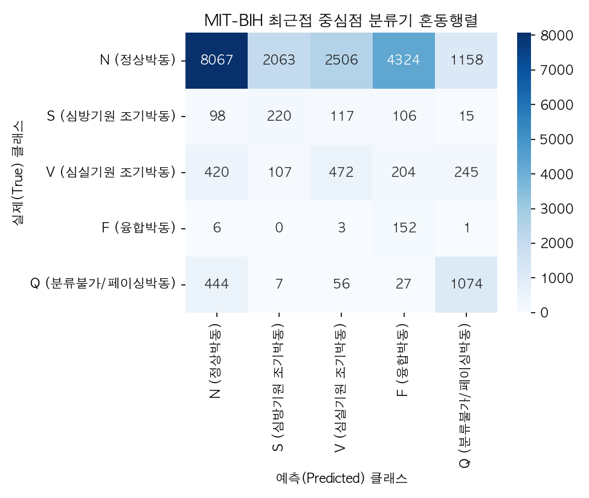
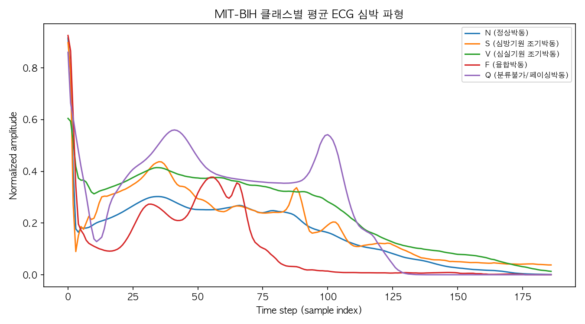
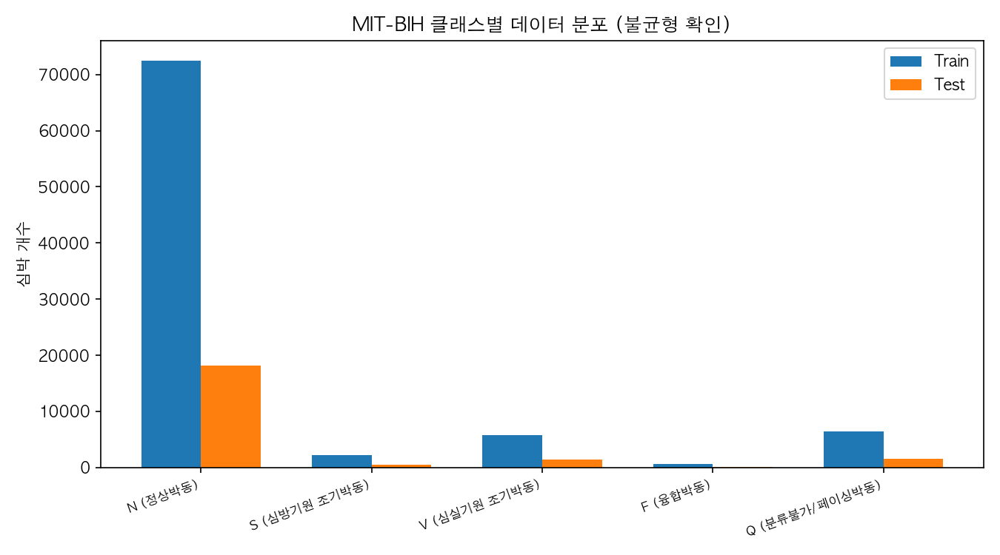
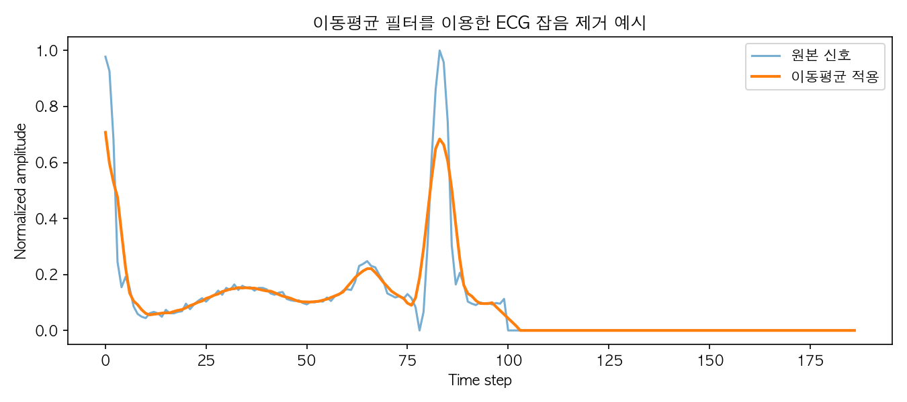
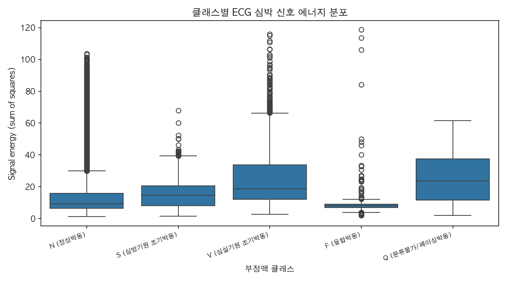
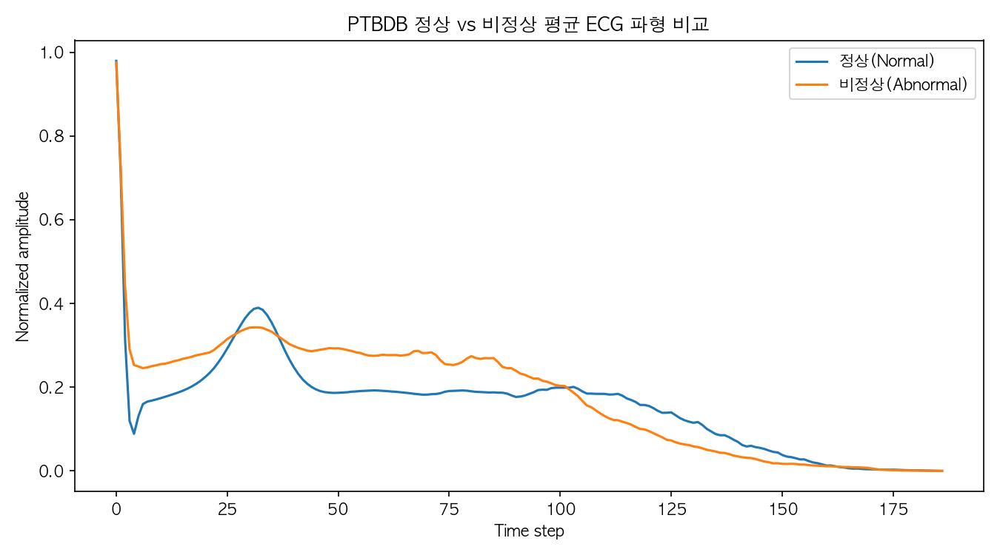
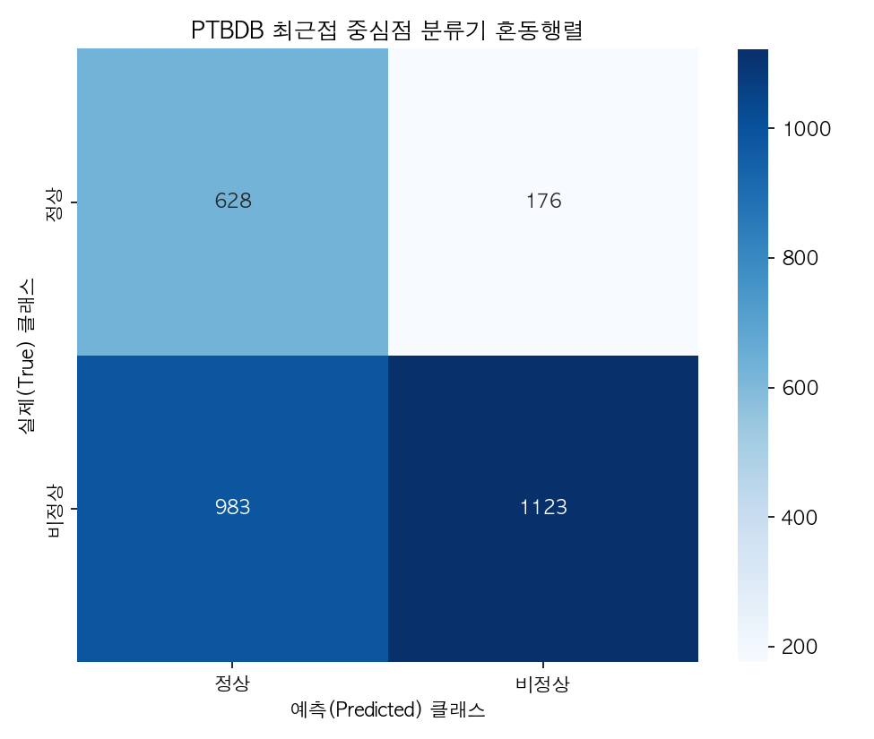

# ECG Nearest Centroid — 머신러닝 라이브러리 없이 만든 심박 분류·시각화 툴

MIT-BIH Arrhythmia와 PTB Diagnostic ECG 심박 데이터를 **numpy만으로 직접 구현한 최근접 중심점(Nearest Centroid) 분류기**로 분류하고, pandas·matplotlib·seaborn으로 결과를 분석합니다.

2026년 1학기 「컴퓨터와 프로그래밍(Python)」 기말과제로, 한 학기 동안 배운 Python 문법(조건문·반복문·함수)과 numpy·pandas·시각화 라이브러리만으로 의공학 데이터 분석 툴을 만드는 것이 목표였습니다. scikit-learn 같은 머신러닝 라이브러리는 쓰지 않았습니다.

## 결과

| 데이터 | 과제 | 정확도 | 클래스별 재현율 |
|---|---|---|---|
| MIT-BIH | 5클래스 (N/S/V/F/Q) | **45.6%** | F 93.8% · Q 66.8% · N 44.5% · S 39.6% · V 32.6% |
| PTBDB | 정상 / 비정상 | **60.2%** | 정상 78.1% · 비정상 53.3% |



**해석.** 평균 파형 모양이 뚜렷이 다른 F·Q는 잘 맞히지만, 평균 파형이 비슷한 N·S·V는 서로 많이 헷갈립니다(N → V 오분류 2,506건). 평균 파형과의 거리 하나만으로는 정상 박동과 조기박동을 구분하기 어렵다는 뜻이고, 실제 진단 알고리즘이 RR 간격·QRS 폭 같은 추가 특징이나 비선형 분류기를 쓰는 이유이기도 합니다.

같은 데이터로 1D CNN을 학습한 결과(정확도 0.98)는 [ecg-arrhythmia-classifier](https://github.com/asclepios-jw/ecg-arrhythmia-classifier)에 있습니다. 이 레포는 **딥러닝 없이 어디까지 되는지**를 보여 주는 기준선입니다.

## 동작 방식

```
CSV 로드 (pandas)  →  이동평균 스무딩  →  클래스별 평균 파형(centroid) 계산
   →  각 심박을 가장 가까운 centroid로 분류 (유클리드 거리)
   →  혼동행렬·재현율 계산 (numpy)  →  그림 7장 저장
```

| 함수 | 하는 일 |
|---|---|
| `load_beat_dataset` | 187샘플 + 라벨 CSV 읽기, 결측치 0으로 채움 |
| `make_binary_dataset` | PTBDB 정상/비정상 합쳐 train/test 분할 (seed 42, 8:2) |
| `smooth_signal` | 이동평균 필터 (window 5) |
| `train_centroid_classifier` | 클래스별 평균 파형 계산 |
| `predict_one` / `predict_batch` | 가장 가까운 centroid 찾기 |
| `evaluate_classifier` | 혼동행렬, 정확도, 클래스별 재현율 |
| `plot_*` | 그림 저장 |

## 그림

| | |
|---|---|
|  클래스별 평균 파형 |  클래스 분포 (N이 대부분) |
|  이동평균 스무딩 예시 |  클래스별 신호 에너지 |
|  PTBDB 정상/비정상 평균 파형 |  PTBDB 혼동행렬 |

## 실행

```bash
pip install -r requirements.txt
python ecg_classifier.py --data data --figures figures
```

### 데이터
Kaggle [ECG Heartbeat Categorization Dataset](https://www.kaggle.com/datasets/shayanfazeli/heartbeat)에서 아래 4개 파일을 받아 `data/`에 둡니다 (용량 문제로 레포에는 포함하지 않음).

| 파일 | 행 수 | 라벨 |
|---|---|---|
| `mitbih_train.csv` | 87,554 | 0~4 (N/S/V/F/Q) |
| `mitbih_test.csv` | 21,892 | 0~4 |
| `ptbdb_normal.csv` | 4,046 | 정상 |
| `ptbdb_abnormal.csv` | 10,506 | 비정상 |

각 행은 심박 1개를 187샘플로 리샘플링·정규화한 값이고, 마지막 열이 라벨입니다.

## 한계와 개선 방향
- 클래스 불균형(N이 약 83%)을 따로 처리하지 않았습니다.
- 평균 파형 하나로 클래스를 대표해서 클래스 안의 다양한 모양을 반영하지 못합니다.
- 개선 방향: RR 간격·QRS 폭 같은 특징 추가, k-NN이나 클래스별 여러 centroid, 또는 CNN

## 데이터 출처
- Moody GB, Mark RG. *The impact of the MIT-BIH Arrhythmia Database.* IEEE Eng Med Biol 2001.
- Bousseljot R, Kreiseler D, Schnabel A. *Nutzung der EKG-Signaldatenbank CARDIODAT der PTB über das Internet.* Biomed Tech 1995.
- Kachuee M, Fazeli S, Sarrafzadeh M. *ECG Heartbeat Classification: A Deep Transferable Representation.* IEEE ICHI 2018. (전처리본)
